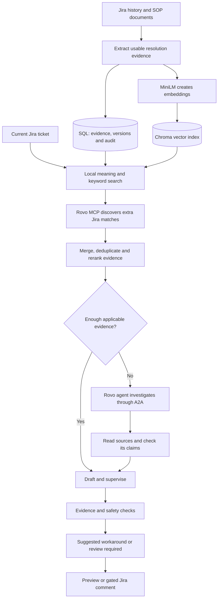

# FalloutAssist demo guide — business and technical audience

Prepared 22 October 2026 from source review and a read-only production inspection. Suggested agenda: 20 minutes. Exact settings/counts below are the 14:41 IST snapshot; recheck the UI before presenting. Detailed evidence and improvement priorities: [Architecture audit](architecture-audit-2026-10-22.md).

## Your opening explanation

> FalloutAssist helps an operations engineer find a supported workaround for a Jira order failure. It reads the current ticket, searches previous resolutions and uploaded procedures, and can use Atlassian Rovo to find additional evidence. It ranks the matches, drafts steps with source references, and checks whether those steps are supported and applicable. When evidence is weak or conflicting, it asks for review. It supplies knowledge; a future action agent would need its own authorization and checks to execute a fix.

For an architect, add:

> LangGraph controls the workflow explicitly. Local retrieval combines MiniLM embeddings in Chroma with lexical search. By default we also fetch Rovo MCP matches, combine and rerank the evidence, and invoke Rovo's A2A agent only when combined evidence is insufficient. The evidence gate runs after drafting and supervision, and publishing is a separate controlled step.

## What the deployment actually uses today

| Question | Accurate statement |
| --- | --- |
| SQL storage | SQLite is active. PostgreSQL is supported by the code but is not the active backend. |
| Vector store | Chroma, persisted separately from SQL. |
| Embedding | `all-MiniLM-L6-v2`, 384 dimensions. |
| Generative service | Azure OpenAI deployment alias `gpt-4o-mini`; provider model revision is not verified by the alias. |
| Keyword search | SQLite FTS5 BM25 now; the PostgreSQL branch uses `ts_rank`, not BM25. |
| Cache | Database-backed reranker cache now. Redis/RedisVL is implemented as an optional backend. |
| Retrieval K | 10 per source; merged rerank pool capped at 10; final shortlist up to 5. Fewer valid matches are allowed. |
| Corpus | 11,091 Jira tickets stored; 5,403 searchable; 5,688 excluded from search for low source quality. |
| Documents | Upload capability exists; no documents were uploaded at the snapshot. |
| Comments | Disabled; previews do not post. |
| Key UI | Named key manager is local code awaiting deployment. Production still has the earlier single-key configuration workflow. |
| Proven accuracy | No independently verified end-to-end accuracy percentage is available. |

The embedding dimensions are documented in the [model card](https://huggingface.co/sentence-transformers/all-MiniLM-L6-v2). Dimensions describe vector length, not the number of business fields or an accuracy percentage.

## Explain the flow in plain language



This diagram shows the current default. Local-only mode bypasses both Rovo paths. Optional local-first mode can skip MCP when local evidence is sufficient. An approved matching rule also has a shortcut.

Use this everyday example without promising it is a verified live fixture:

> A ticket says “Cancel Addon WITH PRORATION” failed with error 14047. We load the ticket through Jira REST. Local search looks for meaning and exact terms such as the operation and error code. Rovo MCP searches Jira for more matching history. We read the actual resolution comments for valid historical tickets, compare applicability, and reject unrelated steps or missing resolutions. Only then do we propose supported steps. The shared error code alone is insufficient.

## Twenty-minute walkthrough

1. **Minutes 0–2: business problem.** Explain repeated manual searching and inconsistent use of past fixes. Describe the assistant and human decision boundary.
2. **Minutes 2–5: knowledge preparation.** Show ingestion totals, searchable/excluded counts, last sync and exact JQL. Explain why a closed ticket without a usable resolution does not become corrective evidence. Show the SOP upload capability without implying any file is already indexed.
3. **Minutes 5–10: one ticket.** Use a ticket whose failure and correct procedure an operator independently understands. Enter its key in Find a workaround. Show confidence, review flag, source links, actual route and elapsed stage information. Open a historical source and compare the suggested action to its resolution.
4. **Minutes 10–12: insufficient evidence.** Show an existing review case and why it abstained. Explain that the gate can reject a draft even after retrieval succeeded. Do not relabel a Low case to improve the demo.
5. **Minutes 12–15: components.** Use the diagram. Distinguish local search, Rovo MCP discovery, Rovo A2A synthesis, SQL storage and Chroma. Explain the current database-cache setting.
6. **Minutes 15–18: integration.** Show Swagger and one read-only Postman example. Explain the async knowledge job for another agent and the possible MCP adapter.
7. **Minutes 18–20: limitations and pilot decision.** State that accuracy and time savings need measurement, present the evaluation plan, and ask who will label cases and own approval.

Before the call: confirm the ticket key, source permissions, TLS trust, deployed feature set and publishing state. The audit did not run a new preview to select a success example. Have a saved result available if Atlassian is slow, and identify it honestly as a saved result. Keep the Rovo agent optional in the live demonstration; the sampled agent path timed out frequently.

## Likely business questions and answers

**1. What business problem does it solve?**

It reduces the effort of finding and comparing prior resolution knowledge for recurring fallout. The expected benefits are faster investigation, more consistent procedures and source visibility. The amount of time saved has not yet been measured in a controlled pilot.

**2. What does the user enter and receive?**

A current Jira issue key produces a ticket investigation: suggested steps if supportable, confidence, review requirement, source references and routing explanation. The user can also filter the saved workaround library by reason, failed step and error.

**3. Does every search box run the agent graph?**

No. In the current UI, entering a ticket key runs the full preview graph. A terms-only search filters saved workaround patterns; expanding a version can prepare its cited synthesis. Explain these as two ways of finding knowledge, with different processing.

**4. Does FalloutAssist fix the order?**

It proposes historical knowledge. It currently does not perform remediation in Aria, Matrixx, Nokia or Salesforce. Optional Jira commenting is an external write, but it is not order remediation.

**5. How accurate is it?**

We have not established a validated end-to-end percentage. We have code-level regression checks, source traceability and conservative evidence rules. A pilot must measure correctness and useful-answer coverage against independently confirmed cases.

**6. Can we say it is 95% accurate because 95 tests passed?**

No. Ninety-five is the number of passing isolated regression tests. They verify behavior such as routing and rejection of unsupported actions, using mocked external services. They do not measure how often a real recommendation resolves a real ticket.

**7. What do the current results tell us?**

In the latest 100 saved reviews at audit time, 90 were Low, 10 Medium, and all required review. This shows the need to examine coverage and gate behavior; the sample has no independent correctness labels, so it is not an accuracy score.

**8. What does High confidence mean?**

The evidence passed the application's applicability, quality, relevance and action-support checks. It is an evidence category, not a guaranteed fix or a calibrated probability. Current system prerequisites still matter.

**9. What does Medium mean?**

There may be a relevant historical lead, but the system requires a person to review it. A Medium result can retain a complete short historical procedure when it is faithfully supported. Some Medium results can have no actionable steps.

**10. Why can the same ticket get a different confidence later?**

The corpus, current ticket, source quality, feedback, model response, available services or gate findings can change. The code preserves valid Medium evidence through fallback failures, but it does not freeze an old rating when evidence becomes conflicting or unsupported. Each saved result is a record of that run.

**11. Why does a commonly recurring issue still return Low?**

The matching resolution may be absent, outside the JQL window, excluded as incomplete, missing required context, ranked out of the pool or rejected by exact procedure checks. A common error is not sufficient if the app cannot trace the applicable procedure. We need to inspect that run's route and source evidence.

**12. Is this better than the old 8010 application?**

It provides more explicit routing, modular specialists, structured source evidence and agent integration. Better output quality and business value require a side-by-side evaluation on identical tickets and source snapshots; we should not claim that comparison has already been proven.

**13. How does the system improve from feedback?**

Feedback and verified version outcomes influence candidate ranking and can block unsuitable evidence. This is application-level feedback, not online model-weight training. Positive feedback does not automatically approve a rule or prove resolution success.

**14. Is the positive-feedback count an accuracy score?**

No. The snapshot has 93 positive and 59 negative votes, but voters and cases are self-selected and are not independently verified outcomes. There were no recorded verified workaround outcomes at the time of inspection.

**15. Who owns the final decision?**

The operational engineer or designated approver owns applying the workaround. A future action agent needs explicit execution authority, live prerequisite checks and an agreed approval policy. The current knowledge package explicitly says it may not execute.

## Ingestion and retrieval questions

**16. Where does the knowledge come from?**

Jira REST reads historical tickets selected by the saved JQL and their resolution comments. Uploaded SOP/reference documents can also supply local evidence. Rovo MCP discovers additional Jira matches, and their actual resolution evidence is read through Jira REST.

**17. What historical scope is active?**

Local history currently uses SAC Order Fallout tickets updated in the last 90 days, with Resolved, Cancelled or Closed status. Rovo historical evidence uses SAC Resolved/Closed tickets. The scope difference is a known audit finding, not something to hide during questions.

**18. Why store tickets that are not searchable?**

The app retains low-quality source records for inspection and audit while excluding them from corrective retrieval. At snapshot time, 5,403 of 11,091 stored tickets were searchable. A ticket marked closed can still lack a usable fix.

**19. What counts as resolution evidence?**

The application looks for meaningful Solution Applied, Resolution, Workaround or Fix content and assesses whether it contains corrective details. Generic “done/closed”, automatic closure, Salesforce activity snapshots and FalloutAssist's own suggestion comments do not establish a usable fix. High source quality is automatic assessment, not human approval.

**20. How does incremental ingestion work?**

The current implementation enumerates the saved JQL scope, compares source update/content/policy versions and avoids re-embedding unchanged records. It is incremental indexing, not a changed-since-only Jira query. A full rebuild is an explicit separate operation.

**21. How frequently is it refreshed?**

The deployed settings are 10 minutes for ingestion and 1 minute for scans. The worker runs these tasks sequentially and waits the interval after completion. Those settings are not guarantees that a long ingestion cannot delay a scan.

**22. How are uploaded SOPs processed?**

The app supports text PDFs, DOCX, TXT and Markdown with bounded size and extraction limits. It retains the original and extracted text, adds applicability metadata and indexes usable passages. PDFs need selectable text; OCR is not implemented. Uploads do not bypass the evidence gate.

**23. Which embedding model is used and how many dimensions?**

The configured model is `sentence-transformers/all-MiniLM-L6-v2`, which outputs 384-dimensional vectors. It runs through Hugging Face/Sentence Transformers. It is a general pretrained embedding model, not one trained specially on our SAC tickets.

**24. What happens to a long ticket or procedure?**

The embedding layer reads the model's input limit, bounds the failure signature and creates overlapping vector passages for the source text, preserving the original evidence. The drafting and reranking layers still have separate text caps; handling complete long prerequisites is an improvement area.

**25. What does Chroma store?**

Chroma stores vectorized searchable passages, their text and source metadata in a persistent vector collection. The relational database stores the original structured evidence, quality, workarounds, configuration, feedback, investigations and audit. The vector store and SQL database are separate storage responsibilities.

**26. What is BM25 and why use it with embeddings?**

BM25 ranks text using matching terms and their frequency/rarity, with length normalization. It helps recall exact error codes and technical terms. Embeddings retrieve similar meaning. In the current SQLite deployment, FTS5 supplies BM25; the optional PostgreSQL branch uses weighted full-text `ts_rank` instead.

**27. What is RRF?**

Reciprocal Rank Fusion combines ranked lists without assuming their raw scores use the same scale: each list contributes `1 / (60 + rank)`. A source appearing near the top of multiple lists gains support. RRF is a ranking method, not proof of procedure correctness.

**28. How does reranking differ from retrieval?**

Retrieval finds a bounded candidate pool. The application's structured LLM reranker compares failure, error, context and resolution evidence for those candidates. The workflow then combines retrieval rank, LLM relevance and feedback/outcome evidence; the evidence gate separately decides whether the result is supportable.

**29. What are the ranking weights?**

The deployed composite weights are 25% retrieval, 50% LLM relevance and 25% feedback/outcome evidence. Sparse feedback is shrunk toward a neutral prior. These weights and routing thresholds are configurable and need calibration; their sum is not a success probability.

**30. Does top K of 10 mean the model reads 20 tickets?**

Not necessarily. Each source can supply up to 10 usable candidates, duplicates are merged, and the combined comparison pool is capped at 10 in the deployed configuration. The final drafting shortlist is at most 5. Filtering and availability can reduce these numbers.

**31. How does it decide there is enough evidence?**

By default it needs at least one traceable, applicable, actionable high-quality source with real reranker relevance at least 0.75, acceptable feedback and no procedure conflict. Failure step, error meaning and known order/release context must match. It does not rely only on vector similarity.

**32. Is 0.75 relevance a 75% probability the fix works?**

No. It is an uncalibrated model relevance threshold used with other evidence checks. The gate can reject an answer with a high relevance score. A success probability would require outcome data and calibration.

**33. What happens when vector search fails?**

The graph records a technical local-retrieval failure and can fall back to MCP. The current local retriever raises before lexical search when a nonempty vector index errors, so independent lexical recovery is a known improvement area.

## Agents and Rovo questions

**34. Which parts are actually agents?**

The Jira specialist and supervisor use LangChain agent construction, and Salesforce is an optional read-only specialist agent. Rovo A2A is an external agent service. Embedding, RRF, parsers, SQL and deterministic gate/routing functions are processing components, not separate agents.

**35. Which agent handles knowledge routing?**

The main LangGraph workflow owns retrieval routing through conditional functions such as `_after_local_search`, `_after_local` and `_after_combined`. It is explicit application logic based on graph state. A separate `knowledge_router.py` graph assembles the FalloutAssist and Rovo proposals for another application.

**36. Does the app always call Rovo?**

Default configured retrieval calls local search plus Rovo MCP. A sufficient combined result skips the Rovo agent. Local-only mode, a local-only backend, an unreadable current ticket and matching approved-rule shortcuts differ; optional local-first mode can skip MCP when local evidence is enough.

**37. What is Rovo MCP doing?**

It gives FalloutAssist access to Atlassian search tools and returns candidate Jira issue keys. FalloutAssist then reads and validates the actual evidence through Jira REST. MCP retrieval alone does not mean Rovo wrote the workaround.

**38. What is Rovo A2A doing?**

It delegates investigation/synthesis to Atlassian's Rovo agent. In the main graph it is a final evidence fallback; in the separate preview/knowledge flow it can produce an independent Rovo proposal. The integrated main-graph fallback validates its sources and claims before accepting actions.

**39. Are the two suggestions independent?**

The downstream package has separate FalloutAssist and Rovo A2A proposals, but they can use overlapping Jira history. Agreement on the same source is not independent corroboration. Inside FalloutAssist, local-source and MCP-source draft branches are generated by our own configured model, rather than both being Rovo agent outputs.

**40. Is the query sent to Rovo identical to the vector query?**

They originate from the same current failure but are adapted differently. Local embeddings use a bounded structured failure signature. Main MCP search uses the ticket query shortened to fit its API. The separate Rovo-preview history path uses normalized failed-step/error text and an exact JQL support query.

**41. Can Rovo search any project and use anything it finds?**

The upstream search sees what the connected credentials allow, but this app then restricts accepted historical evidence to SAC Resolved/Closed and checks the actual source. Permissions and source filtering are both relevant. Rovo finding a key is not enough to authorize a procedure.

**42. What if local and Rovo disagree?**

The app records conflict and requires review rather than presenting a blended procedure as approved. The current conflict matcher is conservative and may also flag differently worded or complementary procedures. We need labeled examples to improve that distinction safely.

**43. Why can Rovo be slow?**

MCP search, Jira evidence reads and remote A2A investigation are separate waits. In the inspected sample MCP p95 was about 3.6 seconds, while the A2A agent had 42 timeouts in 72 attempts. The app bounds the wait and can retain useful local evidence; it cannot guarantee Atlassian's response time.

**44. Is Rovo OAuth needed on every ticket?**

The app saves the authorization and refreshes access tokens. Reconnection can be needed after revocation, refresh failure or policy changes. A2A uses delegated OAuth; the MCP integration in this app uses its separately configured token/email. Atlassian documents these as separate authentication options: [A2A setup](https://support.atlassian.com/atlassian-ai-gateway/docs/set-up-agent2agent-connections/) and [MCP token authentication](https://developer.atlassian.com/cloud/rovo-mcp/guides/configuring-authentication-via-api-token/).

**45. Why did HTTPS authorization get blocked?**

The earlier screen explicitly identified the HTTPS callback domain as restricted by the organization. HTTPS provides transport security; it does not grant organization approval for that callback. The saved connection currently exists, but this audit did not retry consent or verify the current domain policy.

**46. Do we need a Rovo Dev coding token?**

The current application uses Jira REST credentials, an Atlassian MCP V2 search token and Rovo A2A OAuth for different tasks. A Rovo Dev coding-agent token is not part of the implemented workaround flow.

## Reliability, security and operations questions

**47. Where is Redis used?**

Redis/RedisVL is an optional backend for reusing LLM match scores, with strict query/evidence guards. The deployed backend is currently the application database. Do not say Redis is active in this environment.

**48. Does caching skip the safety gate?**

No. The reranker cache reuses relevance scores for a compatible query and evidence fingerprint; feedback/ranking and the final decision still run. Separately, Rovo history and synthesis use encrypted database caches, with different freshness limits.

**49. How long is fetched history reused?**

The separate Rovo preview history cache is five minutes, reusable Rovo synthesis is up to 24 hours for matching site/failure/applicability context, and the current reranker-cache TTL is 60 minutes. These caches serve different purposes; source-update/permission invalidation of reusable synthesis needs improvement.

**50. How do you prevent hallucination?**

Selected-source-only tools, structured outputs, exact source IDs/excerpts, applicability checks, prerequisite/order/negation checks, conflict handling and final rejection reduce unsupported actions. They do not guarantee perfect reasoning, complete source truth or zero hallucinations.

**51. What if an old Jira comment contains malicious instructions?**

Ticket content is treated as untrusted evidence, tools are restricted, and the final gate checks actions against sources. These measures reduce risk, but prompt injection and poisoned source content remain security concerns requiring adversarial evaluation and source governance.

**52. Is customer data protected?**

Some common IDs, long numbers and emails are masked for model calls and comments; connection secrets and OAuth state are encrypted. Raw source text and uploads remain in app storage. Regex masking is not a full DLP/tenant-authorization guarantee, and data handling/retention must be approved.

**53. Is the application secure for wider exposure?**

The current deployment intentionally has open dashboard administration. Session CSRF prevents some browser request attacks but does not authenticate a user. SSO, route authorization, scoped service identities and document-level access controls are prerequisites for broader enterprise access.

**54. Can a service key only search knowledge?**

Currently a valid key also authorizes management APIs, including configuration/ingestion. The new local named-key manager adds names, counts, last use and revocation, but not scopes/expiry. A downstream knowledge consumer should receive a dedicated read-only scope once that control is implemented.

**55. When will it post a Jira comment?**

A scan requests publishing, both publishing settings must permit it, the result must pass the gate without review, and required feedback/public URL settings must be valid. Manual previews and knowledge jobs do not post. Posting is currently disabled in this deployment.

**56. Will it duplicate comments after a retry?**

The app checks its comment marker and publication/body hashes and updates its existing comment where appropriate. Uncertain writes are audited and are not blindly retried. This is application deduplication, not an unconditional distributed exactly-once guarantee.

**57. Is every action auditable?**

Investigations, settings, sources, selected route and publication intents/results are recorded in a hash-linked application audit. Langfuse tracing is optional and currently off. Hash linkage supports detection of changes relative to a trusted copy; it is not an independently immutable external audit store.

**58. Is it immune to OOM or ready for high concurrency?**

No such guarantee has been established. Batch indexing, bounded pools, queue limits and timeouts reduce risk. The inspected worker used about 1.25 GiB RSS, and timed-out work can hold a slot until its transport returns. Capacity/load/restore tests and distributed coordination are still needed.

**59. Does it survive a restart?**

Sources, configuration, investigations and queued-job records persist, and pending jobs can be resumed at startup. The graph itself has no step-level checkpointer. Some work can be replayed, so restart recovery is not equivalent to resuming every node exactly where it stopped.

**60. How much does each ticket cost?**

We have not measured it from billing/token telemetry. Cost depends on rerank, draft and supervisor calls, cache hits, fallback frequency and Atlassian usage. Report cost per useful reviewed/confirmed answer, not only cost per request; prices and contract entitlements need a separate current check.

## Connecting another application or agent

**61. What integration is ready now?**

The REST preview and asynchronous knowledge-job APIs are implemented, with Swagger at `/docs` and schema at `/openapi.json`. Use preview for one grounded investigation and knowledge jobs when the consumer needs the separate FalloutAssist and Rovo proposals plus partial-progress handling.

**62. Can we connect without a custom REST integration?**

Yes, with an adapter. A LangChain tool/subgraph can call the Python implementation in the same process. An MCP tool server can offer discoverable capabilities to other agent runtimes. An inbound A2A server can let independent agents delegate tasks. These adapters are proposed integration options, not implemented features of FalloutAssist today.

| Option | Best use | Current status | Connection boundary |
| --- | --- | --- | --- |
| REST preview/jobs | Any application needing a stable request/result contract | Implemented | Private authenticated HTTPS |
| In-process LangChain tool/subgraph | Another Python agent deployed with FalloutAssist dependencies | Existing functions can be wrapped; adapter not supplied | Same process; host owns identity, config and dependencies |
| MCP tool server | A deep agent should discover and call FalloutAssist as a knowledge tool | Not implemented | Local stdio or authenticated remote HTTP |
| Inbound A2A agent | Independently hosted agents need discovery and task delegation | Not implemented | Authenticated agent endpoint and Agent Card |
| Message/event queue | Bulk inflow, asynchronous workloads and backpressure | External broker integration not implemented | Private broker, request/result events and correlation IDs |

LangChain supports typed callable tools, and MCP supports local stdio as well as remote HTTP communication; see [LangChain tools](https://docs.langchain.com/oss/python/langchain/tools) and [MCP architecture](https://modelcontextprotocol.io/docs/learn/architecture). A2A provides agent discovery, tasks and results through its [documented core concepts](https://a2a-protocol.org/latest/topics/key-concepts/). Remote MCP and A2A still require authenticated service endpoints; these protocols standardize the interface rather than removing the connection boundary.

**63. Which option best fits our future deep agent?**

My architecture recommendation is a small read-only MCP adapter with `request_workaround` and `get_workaround_result`, preserving the existing knowledge-package contract and gate. This is an architectural recommendation, not a benchmark finding. For today's demo use the existing REST jobs; if both agents share one Python process, a direct tool wrapper is simpler. Choose inbound A2A when independent agent task delegation is an explicit requirement.

**64. We already use Rovo A2A — why is another adapter needed?**

FalloutAssist currently acts as a client of Atlassian's A2A service. It does not serve its own Agent Card/task endpoint for other agents. Calling Rovo and exposing FalloutAssist as an A2A agent are two different integration directions. Protocol compatibility should be negotiated; Atlassian documents its gateway's supported version separately: [Atlassian A2A Gateway](https://developer.atlassian.com/cloud/rovo-a2a/).

**65. What exactly must a future action agent receive?**

A versioned structured proposal containing source IDs/URLs, exact supported steps and prerequisites, confidence/review flag, evidence age, route reason and an explicit execution boundary. It must verify live identifiers and current state with its own authorized tools. The present package always returns `may_execute=false`; changing that contract needs a separately designed approval/execution flow.

**66. Can the other agent read Chroma directly?**

Technically it could with shared infrastructure, but that bypasses applicability, evidence gating, auditing and response consistency. Consume a tool or job contract that returns a checked proposal instead of treating raw nearest neighbors as approved actions.

**67. How do the API keys differ from Atlassian credentials?**

The FalloutAssist key authenticates a caller to FalloutAssist. Jira REST credentials let FalloutAssist read/write Jira within that account's permissions. MCP token/email authorizes Atlassian search. A2A OAuth authorizes delegated Rovo interaction. None is a universal replacement for the others.

**68. What if one proposal fails or takes too long?**

The async package can expose partial results and explicit unavailable/pending branches. A cold independent Rovo proposal is refreshed in the background; it is not guaranteed ready with the FalloutAssist result. The consumer must inspect each branch, its review flag and freshness instead of assuming `ready` means approved for action.

**69. Does a tool wrapper need to call the HTTP API?**

An in-process wrapper can invoke the existing Python workflow with publishing disabled, without an HTTP round trip. It must run within the configured FalloutAssist runtime and preserve access control at the host boundary. A remote wrapper can use the API or a future native protocol adapter.

Illustrative proposal only; this wrapper is not currently registered:

```python
from langchain.tools import tool
from falloutassist_next.plugins import ISSUE_KEY
from falloutassist_next.workflow import investigate

@tool
def falloutassist_workaround(issue_key: str) -> dict:
    """Return cited workaround knowledge; review flags do not authorize execution."""
    issue_key = issue_key.strip().upper()
    if not ISSUE_KEY.fullmatch(issue_key):
        raise ValueError("Enter a valid Jira issue key")
    return investigate(issue_key, actor="downstream-agent", publish=False)
```

Initialize storage/configuration once at host startup. This returns the main FalloutAssist result; it does not independently request the second knowledge-package proposal. An async adapter should wrap submit/poll semantics rather than force a long synchronous tool wait.

**70. What should we build next rather than adding more agents?**

First establish labeled accuracy/coverage, authenticated access, scope/freshness policies and reliable fallback behavior. Then add the minimal integration adapter needed by the consuming agent. Additional agents do not correct missing resolution evidence or prove fix success.

**71. Is this RAG or are we training a model on Jira?**

It is retrieval-augmented generation. We index and retrieve evidence to give a pretrained model relevant context. Current ingestion and feedback do not fine-tune the embedding or chat model's weights.

**72. What is the application's ontology?**

It has a practical domain schema: a ticket has a failed operation, error and order/release context; evidence supports a workaround pattern; patterns have procedure versions; versions have source tickets, feedback and outcomes. It is not currently an RDF/OWL ontology or a graph-database knowledge graph. “Knowledge routing” describes workflow decisions over those records.

**73. Is LangGraph like Power Automate?**

Both can represent steps and branches, but this implementation is a Python graph with typed shared state, conditional edges, parallel branches and bounded agent calls. There is no Power Automate-style drag-and-drop graph editor in this UI. Settings change parameters rather than visually redesigning the graph.

**74. How do I prove routing ran in the UI?**

Run a ticket-key preview and expand its result's route details. Point out local search, MCP candidate counts, combined evidence assessment, whether the agent was invoked, and final review reasons. Saved reviews also preserve these fields. A green connection indicator alone does not prove a particular route executed.

**75. Why can fewer than five matching tickets be returned?**

Five is an upper limit for the final shortlist, not a required quota. Source permissions, project/status scope, source quality, failure applicability and deduplication reduce the set. The application should use the valid evidence it has or require review rather than pad the answer with unrelated tickets.

## Postman demonstration

Use a key configured on the same server you are calling. The deployed older key UI requires Save configurations; the new immediate-save named manager is not yet deployed. In Postman Authorization, choose Bearer Token and paste the key. Do not place a real key in presentation screenshots, source files or URLs.

Read stored ingestion status:

```http
GET https://<your-app-host>:8012/api/ingestion/status
Authorization: Bearer {{falloutassist_key}}
```

Run the main ticket preview; the ticket below is an example input, not an audited success fixture:

```http
POST https://<your-app-host>:8012/api/preview
Authorization: Bearer {{falloutassist_key}}
Content-Type: application/json

{"issue_key":"SAC-12345"}
```

For an explicit local-only preview add `"local_only":true`. A normal preview follows the saved local/Rovo mode. Response fields to show: `tier`, `review_required`, `reasons`, `source_details`, `retrieval_route`, and `supervisor_result.draft`. This request does not publish a Jira comment.

Request the separate proposals for another application:

```http
POST https://<your-app-host>:8012/api/knowledge/jobs
Authorization: Bearer {{falloutassist_key}}
Content-Type: application/json

{"issue_key":"SAC-12345"}
```

Expect HTTP 202 with `job_id`/`status_url`; poll the returned path with the same Bearer authorization. Inspect partial/ready/failed states, both proposal statuses and `execution_guidance`. A full queue returns 429. Do not call `/api/scan` as a demonstration of a read-only search.

TLS: configure Postman to trust the app's issuing certificate/CA. If certificate validation fails, distinguish that from an invalid API key or an application routing failure.

## Questions you should ask the stakeholders

These are decisions to obtain, not facts the code can answer for the business. Suggested starting positions are proposals, not agreed commitments.

| Ask | Suggested starting answer for discussion |
| --- | --- |
| Is the first release advisory or allowed to execute actions? | Advisory with an identified human approver. |
| Who can confirm the correct procedure for pilot tickets? | Named SAC operations SMEs, independent of the generated suggestion. |
| Which issue families, statuses, age window and releases are in scope? | A small explicit pilot scope with aligned local/Rovo policies. |
| What level of coverage and erroneous suggestions is acceptable? | Agree measured thresholds by action risk; do not invent an accuracy target in the demo. |
| What response time is acceptable for fast knowledge versus deeper investigation? | Separate a fast answer target from asynchronous A2A; agree measured SLOs after testing. |
| Which downstream agent/platform and deployment model will consume it? | Determine same-process Python, MCP-capable client, A2A client or generic service before choosing the adapter. |
| Which permissions should that caller receive? | Knowledge-only access; management and publishing remain separate roles. |
| What proves a workaround succeeded? | A verified post-condition and linked outcome record, not only a positive vote. |
| Who owns source updates, incorrect SOPs and changed releases? | An accountable knowledge owner with revocation and revalidation procedures. |
| Who owns operations and data handling? | Named service owner, approved retention/access policy, backups and restore responsibility. |

## Claims to avoid

- “It is 95% accurate” or “High guarantees success.” Neither is established.
- “Production uses PostgreSQL and Redis.” The audited environment uses SQLite/database caching.
- “Rovo MCP and Rovo A2A are the same thing.” Their tasks, auth and latency differ.
- “Both paths found the same ticket, so the evidence is independent.” It is one underlying source.
- “Every search runs all agents” or “strong local always skips Rovo.” Default mode fetches both sources; UI terms-only search also differs from a ticket review.
- “It learns by retraining itself on feedback.” Feedback affects application ranking.
- “It already exposes MCP/A2A for another agent.” Only the outbound integrations and REST entry points are implemented.
- “A knowledge result authorizes remediation.” Current packages explicitly disallow execution.
- “A timeout guarantees the underlying work has stopped” or “memory is guaranteed safe.” The runtime does not establish those guarantees.

Close with: **We have an evidence-based workflow and useful integration foundations. The next proof is a measured supervised pilot: correct sourced procedures, useful coverage, bounded latency and verified outcomes.**
