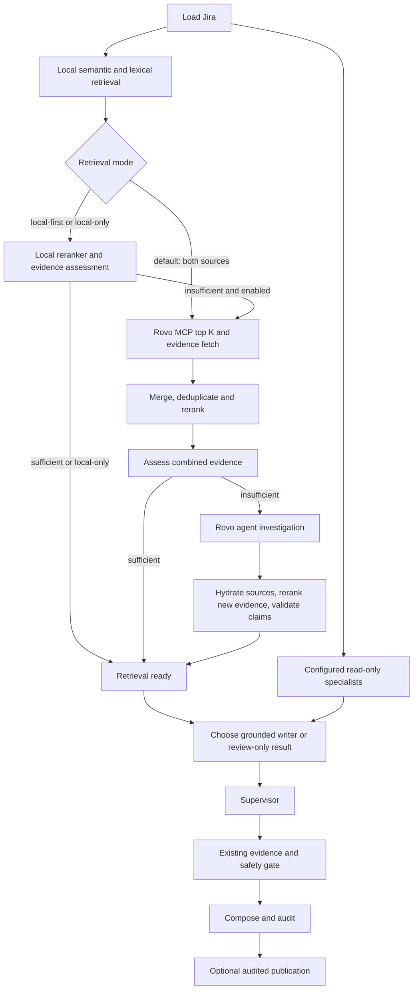

# Combined local and Rovo investigation routing

## Graph map

Previously the main graph was `route -> load_jira -> retrieve_history ->
composite_reranker -> jira_specialist -> supervisor -> quality_gate ->
compose_comment -> persist_audit -> jira_publisher`. Salesforce ran alongside
history retrieval and joined before reranking. The history plugin's combined
mode always called local search and MCP; main-graph retrieval exceptions aborted
the investigation. A2A was a separate free-form preview, not a graph fallback.

The main graph now runs:

`_after_local_search`, `_after_local`, `_after_combined` and `_writer_route` are pure conditional-edge
functions in `workflow.py`. The plugin adapters execute searches; they do not
decide whether evidence warrants escalation. The old combined `search_history`
helper remains available for legacy callers and isolated retriever diagnostics;
the main graph no longer uses it.

The default `rovo_mcp_always_search=true` fetches local top K and MCP top K,
deduplicates by source key, combines ranks with RRF, and runs the real reranker
once on the bounded combined pool. A strong local match does not skip MCP in
this mode. `retrieval_top_k` is the requested usable limit for each source; MCP
discovery is capped at 30 candidates, and source validation can return fewer.
`rerank_pool_k` bounds the merged comparison pool and `jira_review_top_k` bounds
the final drafting context. Turning the setting off restores local-first
assessment and MCP fallback. Local-only requests, a local-only backend, unreadable
current tickets, and approved matching saved fixes retain their shortcuts.

## Evidence decision

One distinct source is sufficient by default only when all of these checks pass:

- The existing real reranker or its guarded cache supplies relevance >= 0.75.
  A disabled/failed reranker's fallback value never counts as assessed evidence.
- The source has an ID, an HTTP(S) URL, actionable high-quality resolution text,
  and the same normalized failed step, error and applicability context.
- Feedback is nonnegative and recorded verified failures do not exceed successes.
- Applicable, relevant sources do not disagree about the procedure. Procedure
  comparison preserves action order, technical values, negation and conditions.

An approved matching rule can supply the procedure without an LLM relevance score.
Similarity and RRF scores still rank candidates, but neither is the sole evidence
decision. A source discovered only by MCP can pass without a fabricated vector
similarity. The final gate repeats applicability and source checks for every
citation and verifies action excerpts, prerequisites and order as before.

The relevance threshold is a routing heuristic, not a calibrated success
probability. Calibrate it using independently confirmed SAC test cases; do not
label existing generated suggestions as correct by assumption.

Successful searches are assessed as empty, weak, conflicting or sufficient.
Search failures are separately recorded as error, timeout or unavailable;
partial MCP results remain distinguishable. Missing or contradictory evidence,
unsupported actions and unfinished investigation stages require review and block
publication even if some intermediate confidence value is medium.
Failed action/source validation clears actionable steps from the final structured
draft, so a downstream consumer cannot mistake a rejected draft for the final
recommendation.

### Confidence and manual review

Evidence confidence and `review_required` are separate. Medium source evidence
remains Medium when MCP or A2A fails, times out, or supplies no stronger evidence;
there is no blanket non-High-to-Low conversion. Better supported evidence can
increase Medium to High. This does not pin a ticket's confidence to an old saved
rating: every new run reassesses current applicability, actual relevance, source
quality and action support. Missing/unverified evidence, invented actions and
conflicting procedures still produce Low with no executable draft.

A review-only result may retain an applicable, really reranked historical lead.
If a complete source procedure is at most 500 characters, the review writer can
quote it faithfully without another model call. It never truncates prerequisites
to fit that bound. Longer or unusable drafts show Medium evidence with no
actionable workaround instead. All retained actions pass the same source-excerpt,
condition and procedure-order checks. Medium routed results explicitly require
review and cannot be posted automatically or treated as approved downstream
actions. A failed agent's unsupported claims cannot authorize a proposal.

## Budgets and execution

Settings are validated and editable through the existing settings API/dashboard:

| Setting | Default | Allowed |
| --- | ---: | ---: |
| `rovo_mcp_always_search` | true | true / false |
| `routing_min_sources` | 1 | 1–5 |
| `routing_min_llm_relevance` | 0.75 | 0–1 |
| `local_retrieval_timeout_seconds` | 10 | 1–60 |
| `routing_rerank_timeout_seconds` | 10 | 1–60 |
| `rovo_retrieval_budget_seconds` | 8 | 1–60 |
| `rovo_agent_budget_seconds` | 30 | 10–120 |
| `investigation_timeout_seconds` | 90 | 30–300 |

Each retrieval stage is attempted once. An absolute monotonic investigation
deadline clamps stage waits; two seconds are reserved for final gating/persistence.
Jira loading and specialist calls have ten-second caps; normal drafting has a
20-second cap and supervision a 15-second cap. The 30-second A2A stage reserves ten
seconds for source hydration and relevance checks (one third for smaller budgets).
Inner model/tool graphs also have recursion limits and routing model calls disable
SDK retries. The main graph is acyclic with a 40-step recursion limit.

Read/model work uses a bounded eight-slot executor without an unbounded backlog;
remote evidence fetching has a separate bounded eight-slot executor. Threads cannot
be forcibly killed: abandoned work can hold a slot until its transport finishes.
Results are copied, and late completions cannot update graph state or initiate
publication. HTTP/model timeouts inherit remaining stage time. Capacity exhaustion
is unavailable, not an empty search. These are application execution limits, not a
guarantee against OS stalls, database outages or production OOM.

Publication stays synchronous on the graph thread, with a maximum ten-second
transport budget clipped to the remaining deadline. No automatic retry follows
an uncertain write; the existing marker/deduplication path reconciles it later.
Audit-before-publish is preserved. Supported results retain the existing publishing
switch policy; every preview and review-required result remains unposted.

## Agent claims and public results

The new evidence-based A2A entry point reuses the saved OAuth connection, trusted
endpoint checks, stream parser and shared A2A lease. It does not repeat MCP discovery,
reread the current ticket, reuse the free-form preview cache or overwrite its result.
The prompt limits investigation to read-only work. The application exposes no Jira
write tool to this fallback; Atlassian's agent permission scope remains separate.

The agent must return structured actions with exact keys and quotations. It can
discover at most five new SAC sources; the app validates resolved/closed scope,
reads actual resolution evidence through configured Jira REST, reranks it, and
checks every proposed action. Current/rejected tickets, arbitrary URLs, inaccessible
sources, malformed output and invented quotations cannot authorize a suggestion.
All new source URLs come from verified Jira records, not agent-supplied URLs.

Existing result fields remain compatible. `retrieval_route`, `review_required` and
`source_details` are additive fields on immediate and saved investigation results.
They are persisted in existing JSON fields, requiring no database migration.
Search route events include `candidate_count` and `requested_top_k` so the UI
shows the actual local/MCP counts separately from evidence confidence.
Route events expose safe stage/status/reason/elapsed data, never credentials or
raw exception messages. The Suggestions card shows the route and why Rovo ran or
was skipped. The connection value `rovo` is unchanged; its UI label is now
**Local history with Rovo MCP**. Settings expose **Always search local + Rovo MCP**.

The manual A2A preview and separate downstream knowledge-proposal flow retain
their independent behavior. Explicit `local_only=True` and the `local` backend
opt out of both fallback integrations in the main graph.
The knowledge package passes through the main result's route, review flag and
source details without changing its independent Rovo-proposal routing.

## Verification and rollout

`tests/test_routing.py` executes the compiled graph with isolated storage, real
evidence gates and mocked external services. It covers default local-plus-MCP
retrieval with one rerank, deduplication and count metadata; optional local-first
results skipping MCP; strong combined results skipping A2A; Medium preservation
during technical failures and promotion with better evidence;
local error/timeout/unavailable/empty/weak
outcomes; agent new-source verification and malformed/unsupported/conflicting
claims; MCP failures retaining local evidence; disabled/default reranker behavior;
local-only and approved rules; deadlines; publication and persisted route metadata.

Run routing tests plus the existing quality, publishing, retrieval, document,
MCP/A2A and knowledge/synthesis regressions. Do not use a publishing scan as a test.
Deploy separately after a consistent operational backup. The preceding token-vector
upgrade has its own stored-evidence reindex procedure; routing alone needs no data
migration or production ingestion. Production accuracy and latency still require
representative, independently labeled SAC cases.
